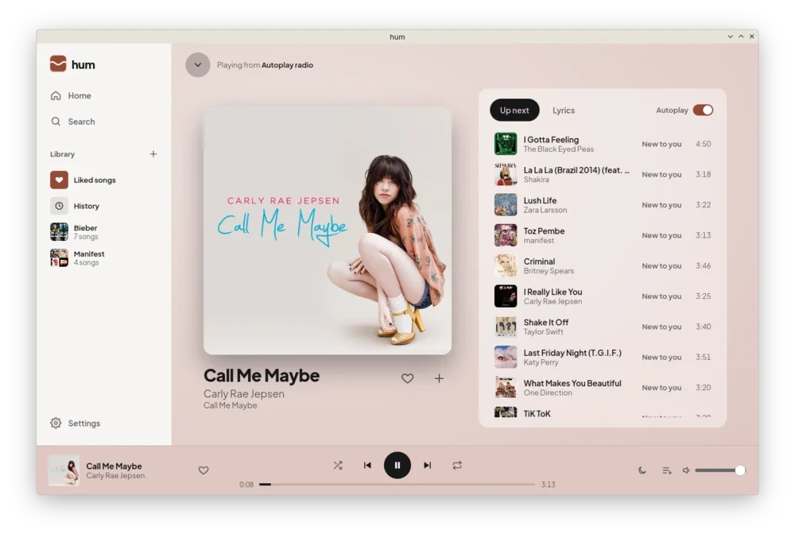
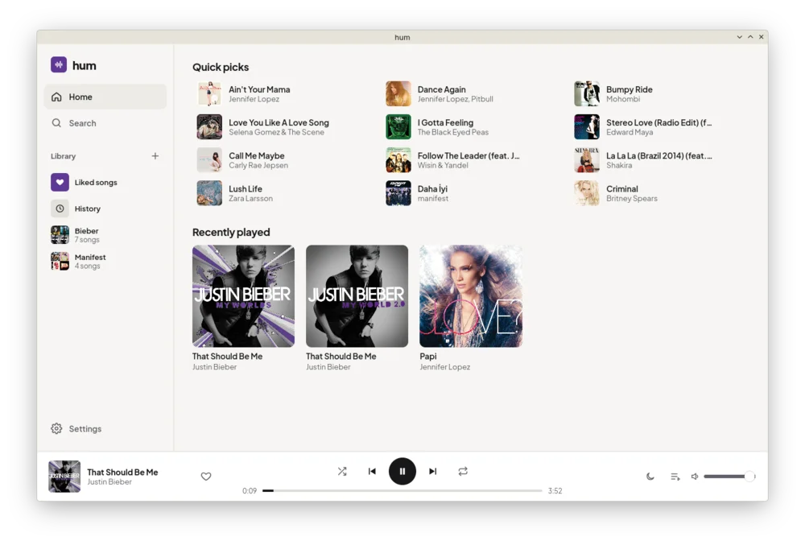
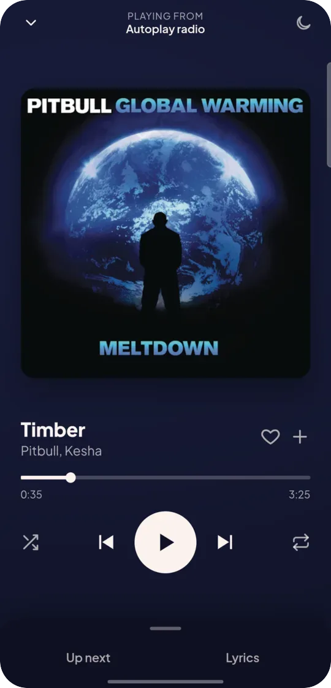
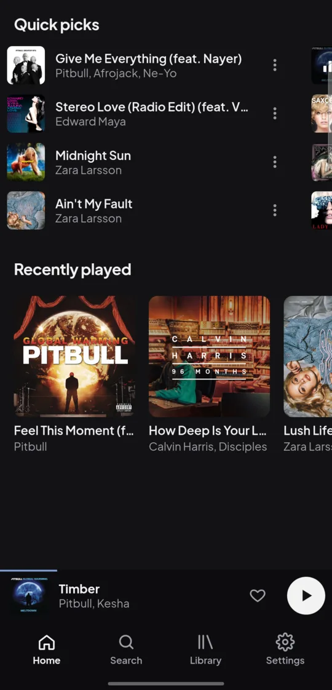

<p align="center">
  
</p>

<h1 align="center">hum</h1>

<p align="center">
  <b>YouTube Music, without the ads, the account or the weight.</b><br />
  A music player for Linux, Windows and Android, made for listening, not tinkering.
</p>

<p align="center">
  
  
  
  
</p>

<p align="center">
  
</p>

## Why hum

- **It starts playing when you tap.** About half a second from tap to sound on a phone, where
  other open-source YouTube Music apps take over two.
- **It stays out of your battery's way.** With the screen off, hum and the system's audio use
  under 3 % of one CPU core; the busiest app we measured used 71 %.
- **Radio that learns from you.** Every song keeps going with songs like it, ranked by what you
  play through and what you skip. All of it is worked out on your device.
- **No account needed.** Search and play straight away. Sign in only if you want your YouTube
  Music likes and playlists.

## A look around

<table>
  <tr>
    <td width="64%" valign="top">
      
      <p align="center"><sub>Home on Linux: quick picks from what you listen to</sub></p>
    </td>
    <td width="18%" valign="top">
      
      <p align="center"><sub>Now Playing on Android</sub></p>
    </td>
    <td width="18%" valign="top">
      
      <p align="center"><sub>Home on Android</sub></p>
    </td>
  </tr>
</table>

## What it does

**Listening**
- Search YouTube Music and play any song, album or artist.
- Endless radio from any song, with a note on each song up next: *You like this*,
  *New to you*, *Not since May*.
- Now Playing takes its colors from the album cover, with synced lyrics from LRCLIB.
- Shuffle, repeat, a sleep timer that fades out, and even loudness between songs.
- Keep an artist out of your radio and quick picks with one click.

**Your library**
- Liked songs, playlists and your listening history, kept on your device.
- Sign in to sync likes and playlists with your YouTube Music account, both ways.
- Clear your listening history to start the recommendations fresh.

**Data and offline**
- Songs you play to the end are kept, so replays cost no data and work offline. You choose how
  much space that takes.
- Download whole playlists, and keep downloads to Wi-Fi on the phone.
- *Auto* sound quality drops to *Data saver* when the connection can't keep up, and Settings
  shows how much data hum has used this month.

**Fits your system**
- Media keys and the system's media controls: MPRIS on Linux, SMTC on Windows, the lock screen
  and notification on Android.
- Keeps playing with the app closed on Android. Light and dark themes everywhere.

## How light it is

Measured on a Galaxy S23 FE against two popular open-source YouTube Music apps, on the same
Wi-Fi, switching between apps in one session. The method and the raw numbers are in
[docs/MOBILE.md](docs/MOBILE.md).

| | hum | SimpMusic 2.5.0 | Metrolist 13.7.0 |
|:--|--:|--:|--:|
| App size | **16 MB** | 27 MB | 26 MB |
| Tap to sound | **0.4–0.7 s** | 2.4 s | 2.1 s |
| CPU while playing, screen off | **2.8 %** | 71 % | – |
| Memory while playing, screen off | 161 MB | 158 MB | – |
| Memory with the app open | 208 MB | ~150 MB | – |

<sub>CPU is the share of one core, counting the system's audio services. Dashes weren't
measured the same way and are left out.</sub>

Where hum loses: its interface is a web page, and with the app open the phone's WebView costs
about 50 MB more than a native interface. Playback itself is native, ExoPlayer with audio
offload on Android and libmpv on desktop, so once the screen is off hum is level on memory and
far ahead on CPU, which is what drains the battery. Desktop numbers are in
[docs/PERFORMANCE.md](docs/PERFORMANCE.md).

## Getting hum

There are no published releases yet.

- **Windows:** each push to `main` builds an installer. Download `hum-windows-x64` from the
  latest [Windows build](../../actions/workflows/windows.yml) run.
- **Linux and Android:** build from source, below.

<details>
<summary><b>Build on Linux (Fedora)</b></summary>

```sh
sudo dnf install webkit2gtk4.1-devel libsoup3-devel gtk3-devel librsvg2-devel mpv-libs mpv-devel
cd ui && npm install && cd ..
./ui/node_modules/.bin/tauri dev      # run it
./ui/node_modules/.bin/tauri build    # or build a package
```

Other distributions need the same libraries: WebKitGTK 4.1, libsoup 3, GTK 3 and libmpv.
</details>

<details>
<summary><b>Build for Android</b></summary>

With the Android SDK and NDK installed:

```sh
cd ui && npm install && cd ..
./ui/node_modules/.bin/tauri android build --apk --target aarch64
```

The environment it needs (NDK paths for bindgen, the JDK version) is in
[docs/MOBILE.md](docs/MOBILE.md).
</details>

<details>
<summary><b>Tests</b></summary>

```sh
cargo test -p hum-core                                      # engine, library, radio
cargo run -p hum-core --example play -- "duman bu akşam"    # play a song with no UI
```
</details>

## How it's built

Rust and [Tauri 2](https://tauri.app), with one Svelte 5 interface for desktop and phone. The
engine (queue, radio, prefetch, Auto quality, library) is Rust and runs unchanged on both; only
the audio backend differs: libmpv on desktop, Media3 ExoPlayer on Android. YouTube Music access
goes through Sonora's [ytmusic-rs](https://github.com/sonorahq/ytmusic-rs), lyrics come from
[LRCLIB](https://lrclib.net), and your library lives in SQLite.

```
crates/core   engine: source, player, queue, radio, library, lyrics (no UI code)
src-tauri     app shell: commands, media controls, cover-art cache, Android bridge
ui            Svelte interface, desktop and phone layouts
docs          design spec, roadmap, measurements
```

More in [DESIGN.md](docs/DESIGN.md) (the design), [ROADMAP.md](docs/ROADMAP.md) (done and
next) and [COMPETITORS.md](docs/COMPETITORS.md) (what other clients get wrong).

## License

GPL-3.0-or-later, as ytmusic-rs is GPL-3. See [LICENSE](LICENSE).

hum is an independent project, not affiliated with or endorsed by YouTube or Google.
